# 第1週　IAMとCloud Run（ストーリー：社内マニュアル回答アプリ立ち上げ）

> **今週の全体ストーリー**
> サポート部門から「社内向け『製品マニュアル回答アプリ』を Google Cloud 上で立ち上げたい（将来は AI 連携や本番運用まで広げたい）」と依頼を受けました。第1週では、最初の最小構成を **安全に動かし始めるまでに必ずぶつかる 4 つの壁**（① 権限境界 → ② 鍵なし認証 → ③ 秘密情報の最小スコープ → ④ 課金暴走防止）を順番に突破していきます。
>
> 用語がわからないときは [学習 用語集（Week 0〜1）](glossary.md) を参照してください（[共通基礎](glossary.md#共通基本用語web--クラウド基礎) / [Part 1](glossary.md#part-1cloud-run-と-3-つの権限境界) / [Part 2](glossary.md#part-2鍵を使わない認証adc--wif--トークン) / [Part 3](glossary.md#part-3リソース階層と-secret-manager) / [Part 4](glossary.md#part-4予算通知とクォータfinops)）。

## Part 1｜第1話：動かしたいのに誰に何の権限を渡す？

> **ストーリー**
> - **依頼・状況**：サポート部門から「社内ポータルから呼べる『製品マニュアル読み取り API』を作ってほしい。社外には非公開、マニュアルの誤改ざん防止のため書き込みは禁止」と依頼を受けた。
> - **作りたいもの**：Cloud Run にマニュアル API をデプロイし、Cloud Storage（`manual-docs` バケット）にある製品マニュアルだけを安全に読み取れるようにする。
> - **直面した課題**：いざ設定すると「デプロイが 403 で失敗」「ポータルにバケット権限を付けても動かない」と混乱。かといって全員に `Editor` を付けると書き込み禁止の要件を破ってしまう。

**例題｜マニュアルを読めるのは誰？**

社内アプリが非公開のCloud Runサービスを呼び出します。開発者がデプロイし、実行中のサービスは指定バケットのマニュアルを読み取ります。鍵ファイルは置かず、書き込みは禁止です。最適な設定はどれですか？

- A. 呼び出し元にStorage Object Viewerを付け、実行時の権限は変更しない。
- B. 呼び出し元に対象サービスのInvoker、開発者にデプロイ権限と実行時IDの利用権限、専用の実行時IDに対象バケットのObject Viewerを付ける。
- C. 開発者と実行時IDの両方に、プロジェクトのEditorを付ける。
- D. 実行時IDに対象サービスのInvokerだけを付ける。

答えと解説を見る

**B。** 呼び出す、デプロイする、データを読む、の3操作には、それぞれ別の主体と対象があります。AとDではStorageを読む主体に必要な権限がありません。Cは実行時の書き込みまで許す可能性があります。

**思考のチャート**

1. **入口** → 呼び出し元に、対象Cloud Runサービスの `roles/run.invoker`。
2. **デプロイ** → 開発者にデプロイ権限。さらに、割り当てるサービスアカウント上で `iam.serviceAccounts.actAs`（例 `roles/iam.serviceAccountUser`）。
3. **実行中** → 専用サービスアカウントに、対象バケットの `roles/storage.objectViewer`。

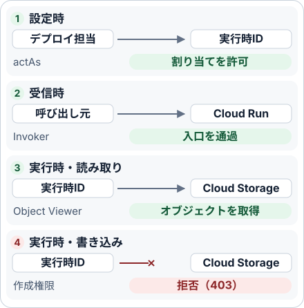

この3つを分けると、「デプロイできたのに動かない」と「呼び出せたのに処理が失敗する」を別々に説明できます。デプロイでは、開発者が**どの権限を持ったIDでコードを実行できるようにするか**が決まります。仮にCloud Runのデプロイ権限だけで、強い権限を持つ任意のサービスアカウントを割り当てられたら、その権限で動くコードを置けてしまいます。そこでGoogle Cloudは、割り当てようとしているサービスアカウントに対する `actAs` を別に確認します。

次はリクエストです。呼び出し元のIDトークンが対象サービス向けで、呼び出し元がInvokerを持っていれば、Cloud Runはリクエストをアプリに渡せます。その後、アプリがStorageに送るリクエストは、Cloud Runに割り当てた実行時IDの権限で評価されます。**入口で200が返るかとは別に、アプリが受け取ったStorageの応答を確認する**と、失敗箇所を判断できます。

**ミニ例題**　デプロイ時に `iam.serviceAccounts.actAs` が拒否されました。どの対象のIAMを見ますか？

答えと解説を見る

割り当てようとしたサービスアカウントです。デプロイ担当に、そのサービスアカウントを利用する権限があるか確認します。

**条件が変わったら**　新規オブジェクトの作成も必要なら、作成を許す権限を追加で検討します。上書きや削除も必要かは個別に確認します。

**GCP Console の該当画面**

- **IAM「許可」ページ**（`IAM と管理 › IAM › 許可` — [Console で開く](https://console.cloud.google.com/iam-admin/iam?hl=ja)）：プロジェクト単位でプリンシパルとロール、過剰権限の警告を確認する画面。

  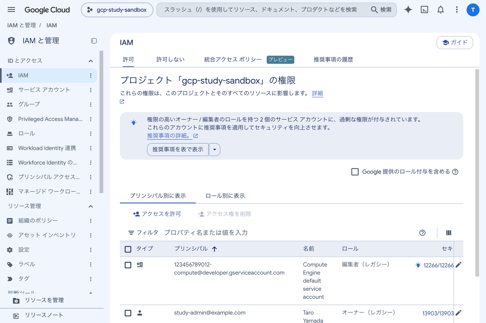

- **Cloud Run「サービス」一覧**（`Cloud Run › サービス` — [Console で開く](https://console.cloud.google.com/run?hl=ja)）：入口の「認証が必要（Invoker）」設定と実行時サービスアカウントを確認する画面。

  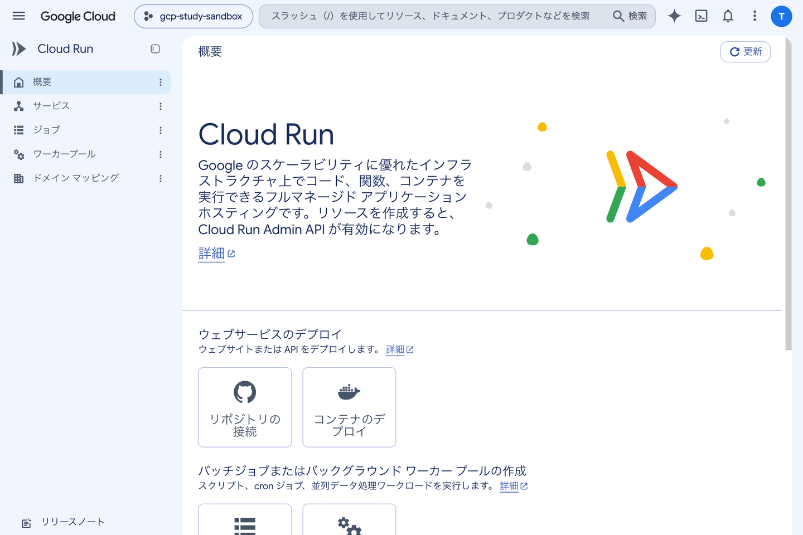

[呼び出し認証](https://docs.cloud.google.com/run/docs/authenticating/overview) ・ [サービスIDの設定](https://docs.cloud.google.com/run/docs/configuring/services/service-identity) ・ [StorageのIAMロール](https://docs.cloud.google.com/storage/docs/access-control/iam-roles)

## Part 2｜第2話：自動化したいが JSON 鍵は絶対 NG

> **ストーリー**
> - **依頼・状況**：第1話で権限境界を設計できたマニュアル API を、チーム開発向けに GitHub Actions（外部 CI）から自動テスト・自動デプロイできるようにしてほしいと依頼された。
> - **作りたいもの**：Cloud Run 上のアプリと外部 CI の両方から、安全に Google Cloud API を呼び出せる認証方式を整える。
> - **直面した課題**：「JSON キーを配れば簡単」と案が出たが、セキュリティ担当から「無期限の鍵ファイルは漏えい事故のもと。1 つも作るな」と却下。さらに「Mac では動くのに Cloud Run では 403」という現象も起きた。

**例題｜同じアプリをCloud Runと外部CIで認証する**

Cloud Run上のアプリと、外部のCIがGoogle Cloud APIを呼びます。外部CIはOIDCトークンを発行できます。どちらにも長期のサービスアカウントキーを配りたくありません。何を使いますか？

- A. 両方で同じJSONキーを使う。
- B. Cloud Runでは割り当てたサービスIDとADC、外部CIではWorkload Identity Federationを使う。
- C. 両方で開発者個人のブラウザログインを使う。

答えと解説を見る

**B。** Cloud RunではApplication Default Credentials（ADC）がメタデータサーバー経由で、割り当てられたIDの短命な認証情報を取得します。外部CIでは、信頼するOIDCのIDを用いて短命のGoogle Cloud認証情報を取得できます。

**思考のチャート**

1. **どこで実行する？** Cloud Run、外部CI、ローカルでは使えるIDの取得元が違います。
2. **誰として呼ぶ？** Cloud Runは実行時ID、CIは許可された外部IDまたは借用するサービスアカウントです。
3. **何を許可する？** トークン取得後のAPIアクセスは、対象リソース側のIAMで決まります。

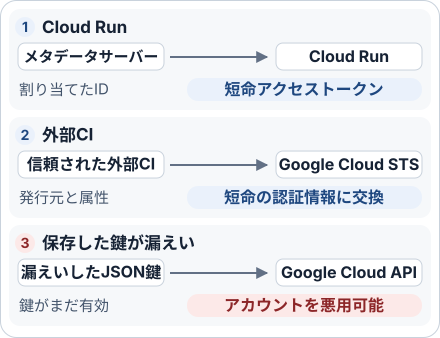

Cloud Runのコンテナにはメタデータサーバーへの経路があります。クライアントライブラリがADCを使い、先に指定された認証情報がなければ、`metadata.google.internal`（リンクローカルアドレス `169.254.169.254`）を通じて、割り当てられたサービスIDのトークンを取得します。トークンには期限があり、ライブラリは必要に応じて取り直します。デプロイ時に秘密鍵をイメージへ入れる必要がないのは、この取得経路が実行環境にあるためです。

Cloud Runの入口に送る**IDトークン**は、相手のサービスが「誰からの呼び出しか」「自分宛てか」を確認するために使います。一方、アプリからStorageなどのGoogle Cloud APIを呼ぶときは、通常 **OAuthアクセストークン**を使います。このときAPIが参照する主体はアプリの実行時IDです。トークンを取得できても、バケット側で該当する操作が許可されている必要があります。

外部CIにはこのCloud Runのメタデータサーバーがありません。Workload Identity Federationでは、Google Cloudが設定した発行元と属性を確認して、外部のOIDCトークンを短命のGoogle Cloud認証情報に交換します。許可対象をリポジトリやブランチなどで絞ると、同じ発行元から来た別のワークロードにも許す、といった設定ミスを防げます。

**ミニ例題**　Macの手動テストは成功し、Cloud Run上ではStorageが拒否されます。最初に何を比べますか？

答えと解説を見る

ローカルとCloud Runがそれぞれ使っているIDです。手元のユーザーが読めても、実行時サービスアカウントに同じデータ権限があるとは限りません。

**条件が変わったら**　Macで動かすだけなら `gcloud auth application-default login` でユーザーのADCを作れます。本番と同じサービスアカウントの権限を試すなら、借用を許可されたユーザーで `--impersonate-service-account` を使います。

**GCP Console の該当画面**

- **IAM「サービス アカウント」一覧**（`IAM と管理 › サービス アカウント` — [Console で開く](https://console.cloud.google.com/iam-admin/serviceaccounts?hl=ja)）：長期 JSON 鍵を発行していないこと（キーなし）と、各 SA の「権限」タブ（`actAs`）を確認する画面。

  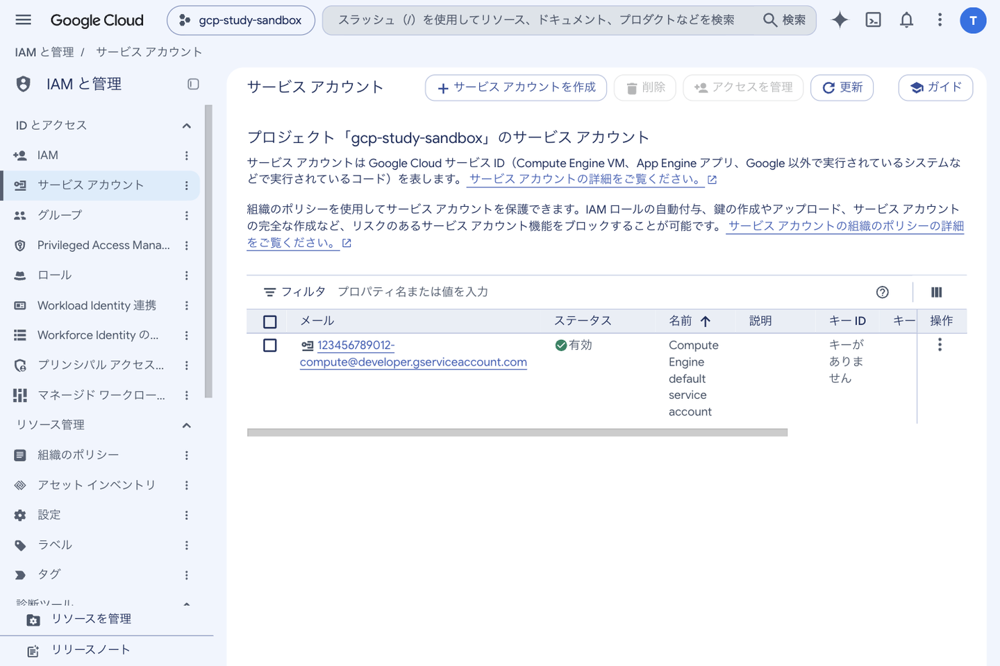

- **Workload Identity 連携**（`IAM と管理 › Workload Identity 連携` — [Console で開く](https://console.cloud.google.com/iam-admin/workload-identity-pools?hl=ja)）：GitHub Actions 等の外部 CI（OIDC）を信頼して短命トークンへ交換するプール管理画面。

  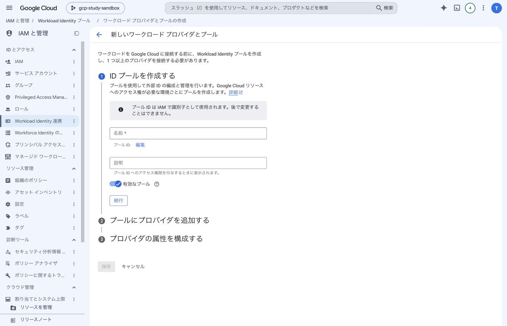

[Cloud RunのサービスID](https://docs.cloud.google.com/run/docs/securing/service-identity) ・ [外部CIのWorkload Identity Federation](https://docs.cloud.google.com/iam/docs/workload-identity-federation-with-deployment-pipelines) ・ [ローカルADC](https://docs.cloud.google.com/docs/authentication/set-up-adc-local-dev-environment)

## Part 3｜第3話：API キーを足したら別の秘密まで見える

> **ストーリー**
> - **依頼・状況**：マニュアル回答の精度を上げるため、「外部の検索・AI API と連携させたい。API キーはコードに直書きせず Secret Manager で管理して」と追加依頼が来た。
> - **作りたいもの**：Cloud Run の実行時 ID に、同じプロジェクト内の複数シークレットのうち「対象 API キー 1 件だけ」を読み取れる権限を与える。
> - **直面した課題**：プロジェクト全体に閲覧ロールを付けたら、他チームが置いた DB パスワード等のシークレットまで読めてしまうことが発覚。子リソース側の設定を空にしても読めてしまう「継承の罠」に直面した。

**例題｜アプリに一つのシークレットだけ読ませる**

Cloud Runの実行時IDに、プロジェクト内にある一つのAPIキーの値だけ読ませたいとします。現在、このIDにSecret Managerの権限はありません。どこで何を付けますか？

- A. プロジェクトにSecret Manager Secret Accessor。
- B. 対象のシークレットにSecret Manager Secret Accessor。
- C. 組織にSecret Manager Admin。

答えと解説を見る

**B。** 対象シークレットに `roles/secretmanager.secretAccessor` を付ければ、その値にアクセスできます。プロジェクトに同じロールを付けると、配下の他のシークレットにも許可が継承されます。

**思考のチャート**

1. **階層をたどる** → 組織 → フォルダ → プロジェクト → 個々のリソース。
2. **許可を合算する** → そのリソースの許可と、上位から継承した許可を確認します。
3. **必要な範囲で付ける** → 1件だけなら、対象のシークレットに絞ります。

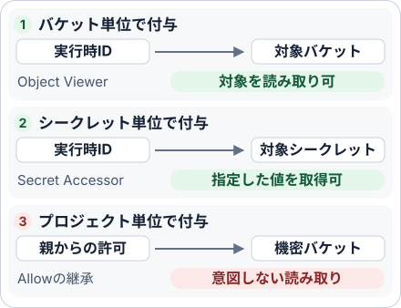

IAMの**有効なAllowポリシー**は、対象リソースの許可と上位から継承した許可の和集合です。たとえば、プロジェクトでStorage Object Viewerを付与すると、新しく作ったバケットにもその許可が継承されます。個々のバケットに同じロールを記載する必要はありません。逆に機密用バケットのAllowポリシーが空でも、プロジェクトからの許可は有効なままです。

あるバケットだけ読める設計に戻すなら、まず上位の広い付与を外せるか確認し、必要なバケットだけに付与します。上位のAllowを維持しながら特定操作を防ぐ要件では、対象の権限が対応していればIAM Denyも候補です。DenyはAllowの合算とは別に評価されます。Secret Managerでも同じ発想で、アプリに必要なシークレットが1件なら、そのシークレットに付与します。

**ミニ例題**　シークレットのIAMに実行時IDが見当たらないのに、値を読み取れます。どこを見ますか？

答えと解説を見る

プロジェクトやフォルダなど上位の許可と、グループなどを通じた付与を確認します。子リソースでの許可付与を省いても、上位の許可は消えません。

**条件が変わったら**　専用プロジェクト内の全シークレットを読む要件なら、プロジェクト単位も候補です。将来追加されるシークレットにも継承される点を確認します。

**GCP Console の該当画面**

- **Secret Manager 一覧・権限**（`セキュリティ › Secret Manager` — [Console で開く](https://console.cloud.google.com/security/secret-manager?hl=ja)）：プロジェクト全体ではなくシークレット単体に `roles/secretmanager.secretAccessor` を付与する画面。

  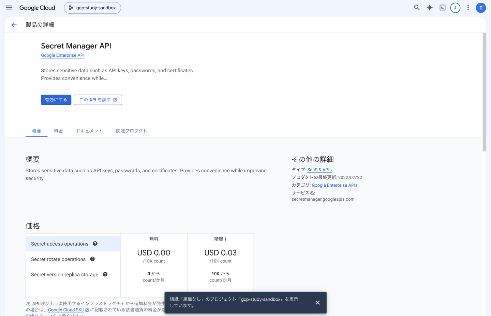

- **IAM「許可しない（Deny）」タブ**（`IAM と管理 › IAM › 許可しない` — [Console で開く](https://console.cloud.google.com/iam-admin/iam?hl=ja)）：上位から継承した Allow より優先して特定操作を止める Deny ポリシーの画面。

  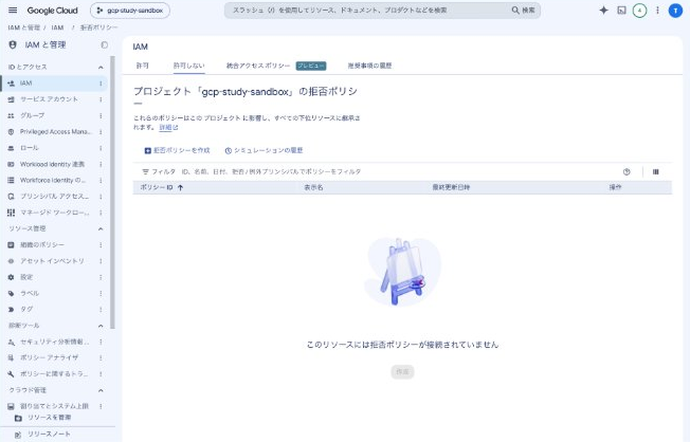

[リソース階層とアクセス制御](https://docs.cloud.google.com/iam/docs/resource-hierarchy-access-control) ・ [IAM Deny](https://docs.cloud.google.com/iam/docs/deny-overview) ・ [Secret Managerのアクセス制御](https://docs.cloud.google.com/secret-manager/docs/access-control)

## Part 4｜第4話：公開直前「予算で課金は止まるよね？」

> **ストーリー**
> - **依頼・状況**：ついにマニュアル回答アプリの社内テスト公開が目前。マネージャーから「検証中にバグやアクセス集中で請求が跳ね上がったら困る。月額予算を設定して上限で止まるようにして」と依頼された。
> - **作りたいもの**：想定外のアクセスやバグが起きても、費用異常に早く気づき、かつ利用量そのものが暴走しない安全な運用ガードレールを整える。
> - **直面した課題**：調べると「Cloud Billing の予算は通知が出るだけで、100% に達しても利用は止まらない」と判明。しかも課金集計には時間差（ラグ）があり、このままでは週末の暴走を防げない。

**例題｜学習用プロジェクトの費用が心配**

月額予算を設定し、到達時に通知を受け取りたいです。チームメンバーは「予算に達すれば利用も止まる」と考えています。何を説明しますか？

- A. 予算の100%でCloud Billingが自動停止する。
- B. 予算は通知用。利用量を抑えたい場合は、対象サービスのクォータや設定を別に調整する。
- C. クォータを1つ設定すれば、プロジェクトの月額請求額に上限を付けられる。

答えと解説を見る

**B。** 予算を作っても利用は継続します。クォータは対象サービスのリソース数などを制限する仕組みで、請求総額を止めるものではありません。

**思考のチャート**

1. **費用に気づく** → Cloud Billingの予算としきい値通知。
2. **特定の利用量を抑える** → 変更可能なクォータや、サービス固有の上限設定。
3. **通知でアクションを起こす** → Pub/Sub通知を処理する別の仕組み。請求情報と通知には遅延があり得ます。

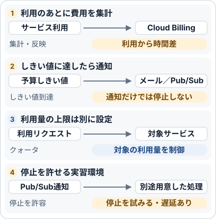

**リクエストを受け付ける時刻と、その費用が予算に反映される時刻は違います。** たとえばCloud Runで追加の処理が始まった時点では、Cloud Billingがその分の費用をまだ集計していないことがあります。予算は反映された費用や予測額を見て通知するため、各リクエストの前に残額を同期的に判定する仕組みとしては使えません。Pub/Subで通知を受けて処理を止める設計にも、集計、通知、停止処理までの時間差が残ります。

一方、サービスのクォータや同時実行数などの設定は、何をその場で受け付けるかに作用します。費用を監視する仕組みと、使いすぎを抑える仕組みを組み合わせるときは、「どの利用量を抑えると費用が下がるか」まで結び付けて考えます。

**ミニ例題**　本番で予算超過通知を受けたら、課金を自動で無効化してよいですか？

答えと解説を見る

課金無効化はサービス停止を招き得ます。本番で継続稼働が要件なら、まず担当者への通知と、利用量の多い対象を絞った対応を設計します。

**条件が変わったら**　停止を許容する使い捨ての実習プロジェクトなら、通知を起点とした自動化も候補です。遅延があるため、設定額で確実に支出が止まるとは見なしません。

**GCP Console の該当画面**

- **お支払い「予算とアラート」**（`お支払い › 予算とアラート` — [Console で開く](https://console.cloud.google.com/billing/budgets?hl=ja)）：しきい値通知（メール／Pub/Sub）の設定画面。自動停止スイッチはない。

  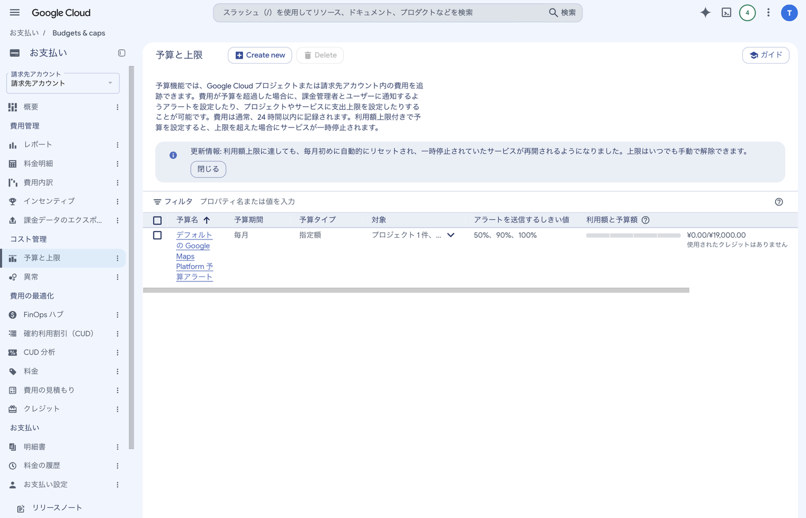

- **割り当てとシステム上限**（`IAM と管理 › 割り当てとシステム上限` — [Console で開く](https://console.cloud.google.com/iam-admin/quotas?hl=ja)）：サービスごとの利用量を同期的に制御するクォータ画面。

  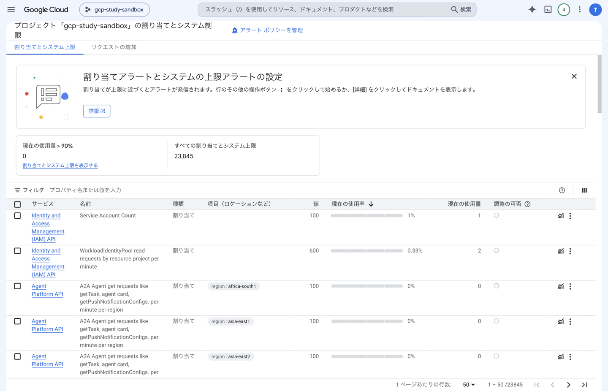

[予算とアラート](https://docs.cloud.google.com/billing/docs/how-to/budgets) ・ [予算通知に応じた処理](https://docs.cloud.google.com/billing/docs/how-to/notify)

## MacBookでラボを始める前に

架空のマニュアルアプリを想定し、次の3問に一言ずつ予測を書いてから[第1週の演習](../labs/README.md#第1週-iamとcloud-run)へ進みます。

1. 呼び出し元のInvokerを外すと、リクエストはどこで止まる？
2. 開発者が実行時IDを利用できないと、どの操作が失敗する？
3. 実行時IDが対象バケットのObject Viewerだけを持つとき、読み取りと新規書き込みはそれぞれどうなる？

実習後は、予測と実際の違いを[進捗](../PROGRESS.md)に記録します。
